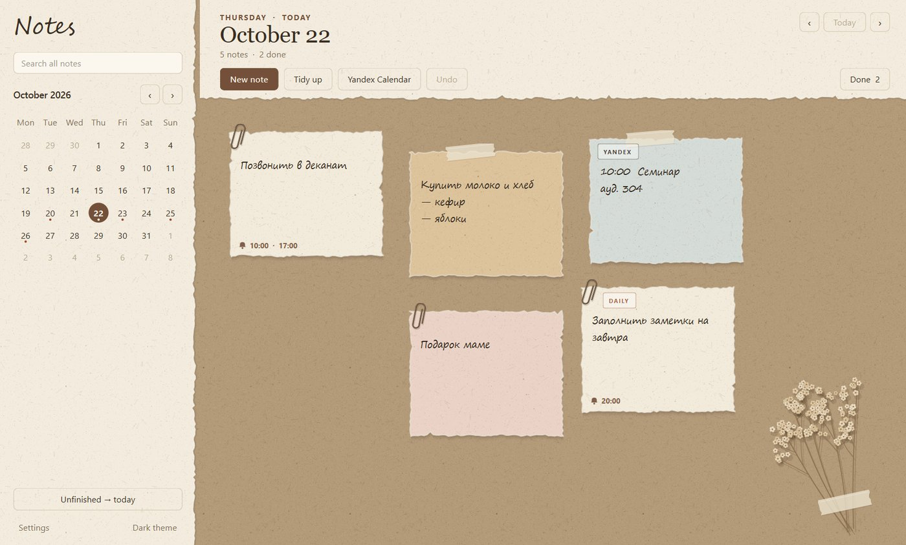
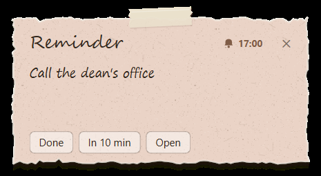
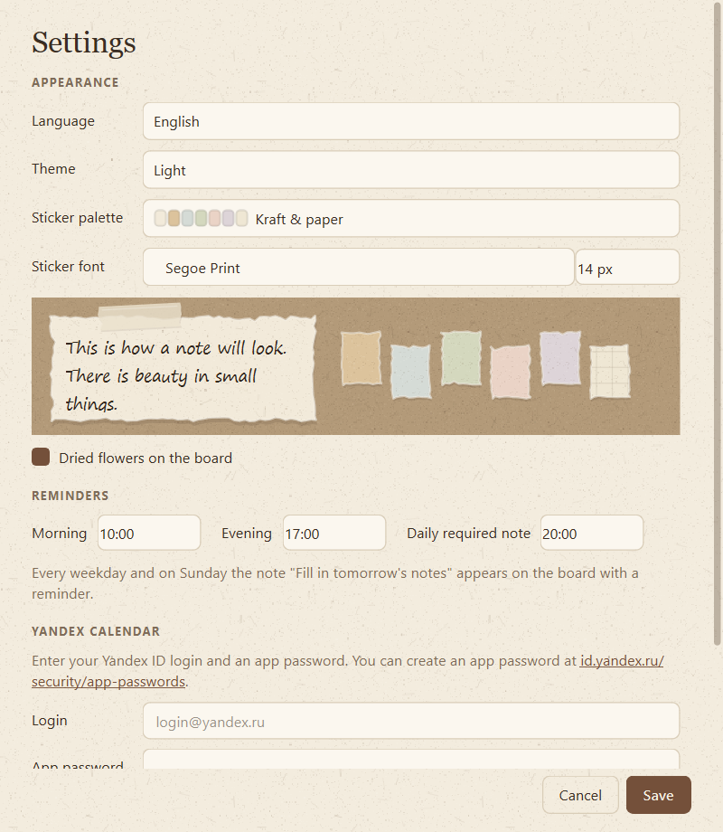
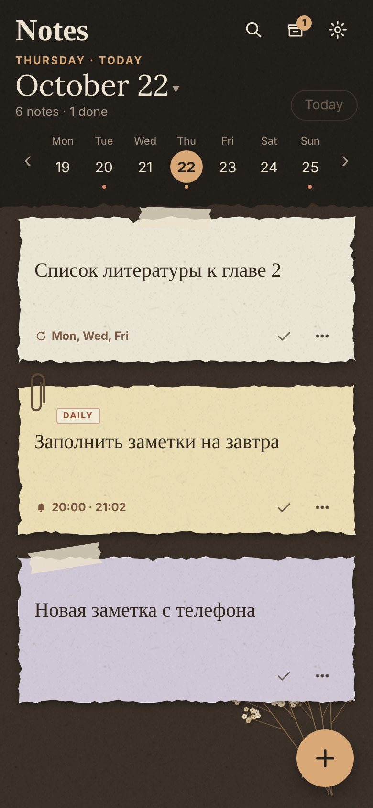
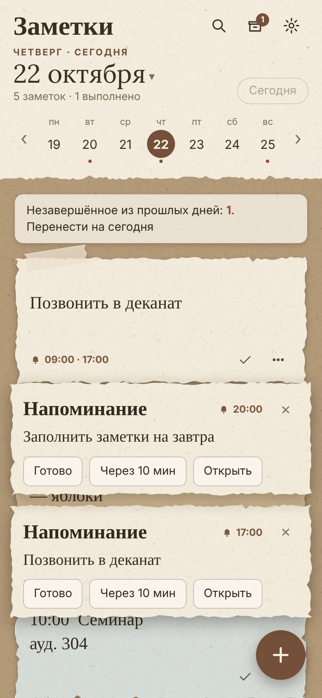
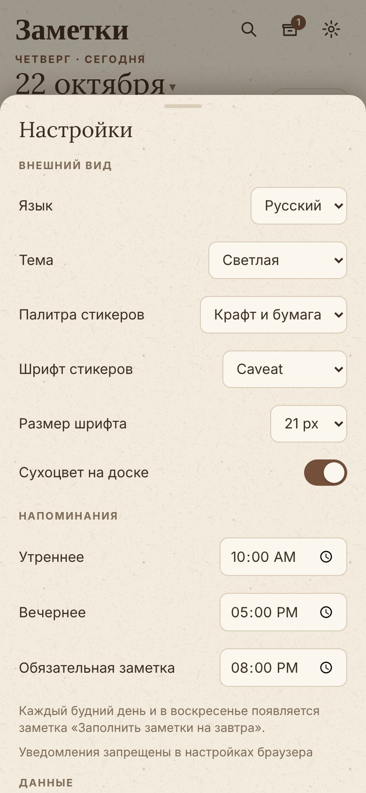

# Notes

[Русский](README.md) · **English**

A day-by-day notes board for Windows, macOS, Linux and Android: torn paper on kraft, a calendar, reminder notifications, repeating notes and Yandex Calendar import.

| System | File in Releases |
|---|---|
| Windows 10/11 | `Notes-windows.zip` |
| macOS (Apple Silicon) | `Notes-macos.zip` |
| Linux (x86-64) | `Notes-linux.tar.gz` |
| Android 8+ | `Notes-android.apk` |
| Any browser | mobile web version on GitHub Pages (see below) |



## Features

- **A board for every day.** Move, resize, recolour and tidy stickers into rows. Double-click the board to add a note.
- **Calendar.** Days with notes are marked with dots. Move between days with buttons or keyboard shortcuts.
- **Reminders.** A note reminds you twice a day, at 10:00 and 17:00 by default; both times can be changed. A note created after 12:00 gets one reminder that day, in the evening. The notification pops up at the bottom right of the screen with a sound and three buttons: *Done*, *In 10 min* and *Open*.
- **Repeat.** A note can repeat every day, on weekdays, on chosen days of the week, or monthly on the same date.
- **Daily required note.** Every weekday and on Sunday the note *Fill in tomorrow's notes* appears with an evening reminder.
- **Move.** Send a note to any day with *Tomorrow*, *Day after*, *Monday*, *In a week* or the calendar. Unfinished notes from past days move to today in one click.
- **Archive and search.** Completed notes go to the day's archive, where they can be restored. Search covers all days.
- **Look.** Light and dark themes, four sticker palettes (Kraft & paper, Pastel, Nature, Classic), font and size choice, dried flowers on the board.
- **Languages.** Russian (default) and English.
- **Yandex Calendar.** The chosen day's events are imported as notes, and the same event is never added twice.
- **Conveniences.** Tray icon, start at login, desktop shortcut, undo (Ctrl+Z).

| Notification | Settings |
|---|---|
|  |  |

## Installing

### Windows

1. Download `Notes-windows.zip` from **Releases**.
2. Unpack it anywhere, for example into Documents.
3. Run `Notes\Notes.exe`. To add a desktop shortcut, go to *Settings → System → Create desktop shortcut*.

You don't need Python for this. On first launch Windows SmartScreen may warn about an unknown publisher: click *More info* → *Run anyway*.

### macOS

1. Download `Notes-macos.zip`, unzip it and drag **Notes.app** into Applications.
2. The app isn't signed with an Apple certificate, so open it like this the first time: right-click Notes.app → *Open* → *Open*. After that it launches normally.
3. The icon appears in the menu bar. Turn on autostart in *Settings → System*.

The build is for Macs with Apple chips (M1 and newer).

### Linux

```sh
tar -xzf Notes-linux.tar.gz -C ~/Applications   # or any folder
~/Applications/install.sh                        # adds Notes to the app menu
```

You can also run `Notes/Notes` directly. The tray icon shows up if your desktop supports it (KDE, Cinnamon, XFCE; GNOME with the AppIndicator extension). Without a tray, closing the window quits the app.

### Android

1. Download `Notes-android.apk` to the phone.
2. Open it and allow installs from that source if asked.
3. Allow notifications on first launch.

In the Android app, reminders arrive as **scheduled system notifications, even when the app is closed**. Notes are stored inside the app. The Back button closes open panels, and backups are saved through *Share*, so you can send them to yourself or save them to Files.

### From source (Windows, macOS, Linux)

You need Python 3.10 or newer.

```sh
pip install -r requirements.txt
python tools/fetch_fonts.py fonts   # optional: bundled Caveat, Lora and other fonts
python notes.py                     # on Windows, pythonw notes.py runs without a console
```

Command-line options:

| Option | What it does |
|---|---|
| `--tray` | start minimised to the tray (used by autostart) |
| `--make-shortcut` | create a desktop shortcut |
| `--selftest [folder]` | run the UI on sample data and save window screenshots and a report |
| `--build` | build the exe with PyInstaller |

## Building

### On GitHub (all systems at once)

The `.github/workflows/build.yml` workflow builds Windows, macOS and Linux versions plus an Android APK. On each system it runs the self-test: the UI on sample data, screenshots of every window and a report. The Android job launches the app in an emulator and takes a screenshot.

- Manual run: **Actions** → **Build apps** → **Run workflow**. Built files and self-test screenshots appear under **Artifacts** at the bottom of the run page.
- Pushing a tag such as `v3.1` (`git tag v3.1 && git push --tags`) also attaches the files to the release.

### Locally

- **Windows:** `build.bat` or `python notes.py --build`, which produces `dist\Notes\Notes.exe`.
- **macOS and Linux:** `python notes.py --build`, which produces `dist/Notes.app` or `dist/Notes/Notes`.
- **Android:** you need Node.js 20, JDK 21 and the Android SDK. Run:
  ```sh
  python tools/fetch_fonts.py fonts
  cd mobile-app && npm install && npm run android
  cd android && ./gradlew assembleDebug
  ```

## Mobile version

The [`docs/`](docs) folder holds a web app (PWA) with the same features and look: day boards, reminders, repeats, the daily note, moving notes, archive, search, palettes, fonts, dark theme, Russian and English.

<p>
  
  
  
</p>

This is the browser option, with nothing to install. On Android the app from Releases is the better choice: its reminders arrive even when it's closed.

**Publishing:** in the repository, open **Settings** → **Pages**, set **Source** to **Deploy from a branch**, then pick branch `main` and folder `/docs`. A minute later the app is live at `https://<user>.github.io/<repo>/`.

**Installing on a phone:** open that address on the phone. In Chrome on Android: menu → *Add to Home screen*. In Safari on iPhone: *Share* → *Add to Home Screen*. After the first visit it works offline.

Notes are stored on the phone, in the browser's storage. To move them between devices, use *Export notes* and *Import notes from a file* in Settings. The file format is the same as the Windows version's `.stickies_data.json`, so you can carry notes either way; imported notes are added to the existing ones.

> On phones, reminders arrive while the app is open or recently backgrounded. Web apps can't reliably wake a phone on a schedule the way native apps do.

## Yandex Calendar

1. Create an app password at [id.yandex.ru/security/app-passwords](https://id.yandex.ru/security/app-passwords) (type: Calendar CalDAV).
2. Enter your login and that password in Settings.
3. Click *Yandex Calendar* on the day you want.

If Windows has a system proxy configured that doesn't respond, the app retries the Yandex request directly.

## Where data lives

| What | Where |
|---|---|
| Notes | `.stickies_data.json` in your home folder (`%USERPROFILE%` on Windows, `~` on macOS and Linux) |
| Settings | `.stickies_config.json` in the same place |
| Error log | `stickies.log` next to the app |
| Android | inside the app; move notes with *Export* and *Import* |

The notes file is written atomically, so a crash while saving can't corrupt it. Before a new version first runs, the app backs up your notes. The Yandex app password is stored in the settings file in plain text. Use an app password rather than your main password: you can revoke it at any time.

## Keyboard shortcuts

| Keys | Action |
|---|---|
| Ctrl+N | new note |
| Ctrl+Z | bring back the last removed note |
| Ctrl+T | go to today |
| Ctrl+F | search |
| Alt+← / Alt+→ | previous / next day |

## Repository layout

```
notes.py                    app for Windows, macOS and Linux (PySide6), single file
notes.ico, notes.png        icons
requirements.txt            dependencies
build.bat                   exe build on Windows
tools/fetch_fonts.py        downloads free fonts for builds
packaging/linux/            Linux app-menu installer
docs/                       mobile version (PWA), also the base of the Android app
mobile-app/                 Android project (Capacitor): notifications, icons, APK build
screenshots/                README images
.github/workflows/build.yml build and self-test on every system
```

## License

[GPL-3.0](LICENSE). You may use, modify and share the code freely, but derivative projects must also be released under GPL-3.0 with their source code open.

The Caveat, Marck Script, Lora, PT Sans and PT Serif fonts bundled at build time are licensed under the SIL Open Font License 1.1.
