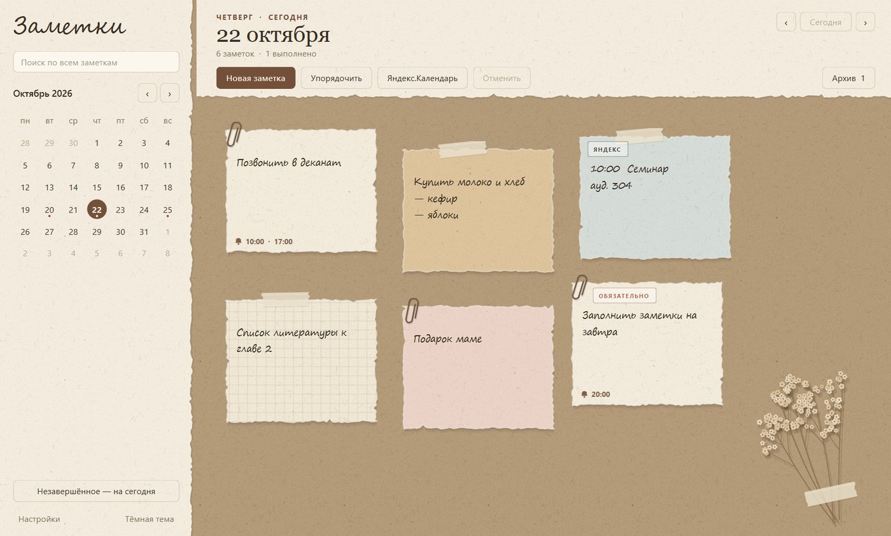
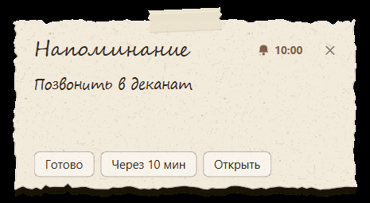
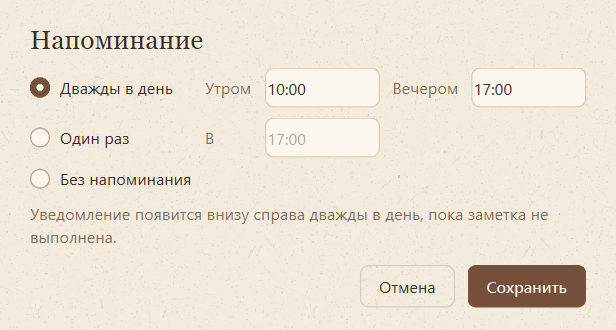
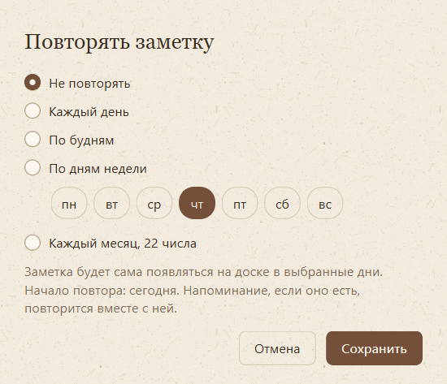
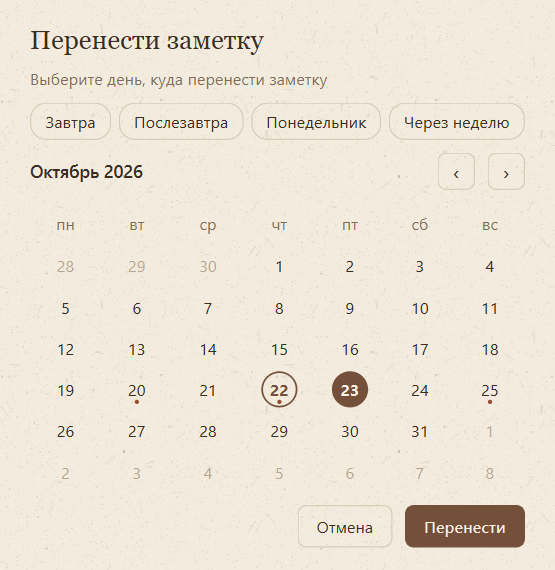
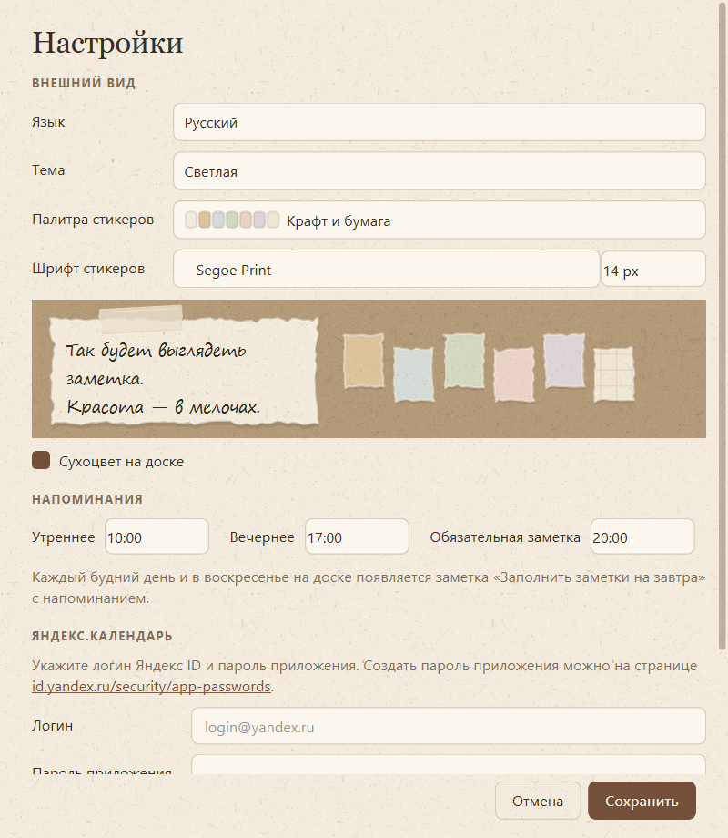
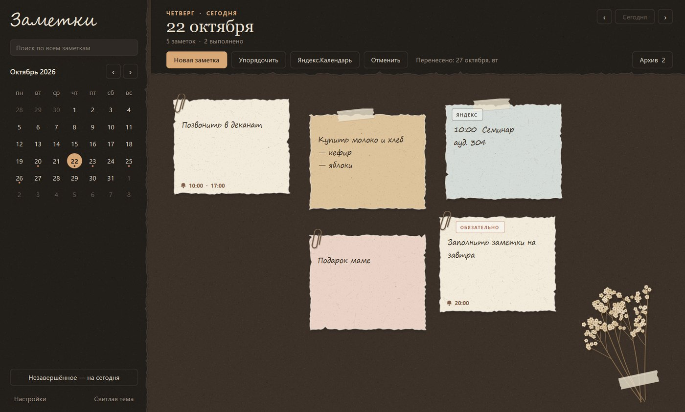
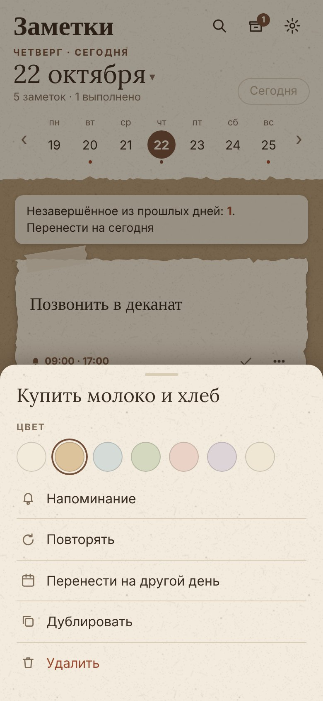

# Заметки

**Русский** · [English](README.en.md)

Доска заметок по дням для Windows, macOS, Linux и Android: рваная бумага на крафте, календарь, напоминания-уведомления, повторяющиеся заметки и загрузка событий из Яндекс.Календаря.

| Система | Файл в Releases |
|---|---|
| Windows 10/11 | `Notes-windows.zip` |
| macOS (Apple Silicon) | `Notes-macos.zip` |
| Linux (x86-64) | `Notes-linux.tar.gz` |
| Android 8+ | `Notes-android.apk` |
| Любой браузер | мобильная версия на GitHub Pages (см. ниже) |



## Возможности

- **Доска на каждый день.** Стикеры можно двигать, растягивать, красить и упорядочивать рядами. Двойной щелчок по доске создаёт новую заметку.
- **Календарь.** Дни с заметками отмечены точками. Переход между днями кнопками и сочетаниями клавиш.
- **Напоминания.** Заметка напоминает о себе дважды в день: по умолчанию в 10:00 и 17:00, время настраивается. Если заметка создана после 12:00, напоминание сегодня одно, вечером. Уведомление появляется в правом нижнем углу экрана со звуком и кнопками «Готово», «Через 10 мин» и «Открыть».
- **Повтор.** Заметка может повторяться каждый день, по будням, по выбранным дням недели или каждый месяц в одно и то же число.
- **Обязательная заметка.** Каждый будний день и в воскресенье на доске появляется заметка «Заполнить заметки на завтра» с вечерним напоминанием.
- **Перенос.** Заметку можно перенести на любой день: кнопки «Завтра», «Послезавтра», «Понедельник», «Через неделю» и календарь. Незавершённое из прошлых дней переносится на сегодня одной кнопкой.
- **Архив и поиск.** Выполненные заметки уходят в архив дня, откуда их можно вернуть. Поиск идёт по всем дням.
- **Внешний вид.** Светлая и тёмная темы, четыре палитры стикеров («Крафт и бумага», «Пастель», «Природа», «Классика»), выбор шрифта и размера, сухоцвет на доске.
- **Языки.** Русский (по умолчанию) и английский.
- **Яндекс.Календарь.** События выбранного дня загружаются как заметки, повторно одно и то же событие не добавляется.
- **Удобства.** Значок в трее, автозапуск при входе в систему, ярлык на рабочем столе, отмена последнего действия (Ctrl+Z).

| Уведомление | Напоминание | Повтор |
|---|---|---|
|  |  |  |

| Перенос на другой день | Настройки | Тёмная тема |
|---|---|---|
|  |  |  |

## Установка

### Windows

1. Скачайте `Notes-windows.zip` из раздела **Releases**.
2. Распакуйте архив в удобную папку, например в «Документы».
3. Запустите `Notes\Notes.exe`. Ярлык на рабочем столе создаётся в «Настройки» → «Система» → «Создать ярлык на рабочем столе».

Python для этого не нужен. При первом запуске Windows SmartScreen может предупредить о неизвестном издателе: нажмите «Подробнее» → «Выполнить в любом случае».

### macOS

1. Скачайте `Notes-macos.zip`, распакуйте его и перетащите **Notes.app** в папку «Программы».
2. Приложение не подписано сертификатом Apple, поэтому первый раз откройте его так: правой кнопкой по Notes.app → «Открыть» → «Открыть». Дальше оно запускается как обычно.
3. Значок появится в строке меню вверху экрана. Автозапуск включается в «Настройки» → «Система».

Сборка рассчитана на Mac с процессором Apple (M1 и новее).

### Linux

```sh
tar -xzf Notes-linux.tar.gz -C ~/Applications   # или любая другая папка
~/Applications/install.sh                        # добавит «Заметки» в меню приложений
```

Программу можно запустить и напрямую: `Notes/Notes`. Значок в трее появляется, если окружение рабочего стола его поддерживает (KDE, Cinnamon, XFCE; в GNOME — с расширением AppIndicator). Без трея закрытие окна завершает программу.

### Android

1. Скачайте на телефон `Notes-android.apk`.
2. Откройте файл и разрешите установку из этого источника, если телефон спросит.
3. При первом запуске разрешите уведомления.

В приложении для Android напоминания приходят **системными уведомлениями по расписанию, даже когда приложение закрыто**. Заметки хранятся в самом приложении. Кнопка «Назад» закрывает открытую панель, а копия заметок сохраняется через «Поделиться»: её можно отправить себе или положить в «Файлы».

### Из исходного кода (Windows, macOS, Linux)

Нужен Python 3.10 или новее.

```sh
pip install -r requirements.txt
python tools/fetch_fonts.py fonts   # по желанию: встроенные шрифты Caveat, Lora и др.
python notes.py                     # в Windows можно pythonw notes.py — без окна консоли
```

Ключи запуска:

| Ключ | Что делает |
|---|---|
| `--tray` | запуск свёрнутым в трей (так работает автозапуск) |
| `--make-shortcut` | создать ярлык на рабочем столе |
| `--selftest [папка]` | прогнать интерфейс на пробных данных и сохранить снимки окон и отчёт |
| `--build` | собрать exe через PyInstaller |

## Сборка

### На GitHub (все системы сразу)

Workflow `.github/workflows/build.yml` собирает версии для Windows, macOS, Linux и APK для Android. На каждой системе он прогоняет самопроверку: интерфейс на пробных данных, снимки всех окон и отчёт. На Android приложение запускается в эмуляторе, и делается снимок экрана.

- Вручную: вкладка **Actions** → **Build apps** → **Run workflow**. Готовые файлы и снимки самопроверки лежат внизу страницы запуска, в разделе **Artifacts**.
- При публикации тега вида `v3.1` (`git tag v3.1 && git push --tags`) файлы ещё и прикладываются к релизу.

### Локально

- **Windows:** `build.bat` или `python notes.py --build`, результат — `dist\Notes\Notes.exe`.
- **macOS и Linux:** `python notes.py --build`, результат — `dist/Notes.app` или `dist/Notes/Notes`.
- **Android:** нужны Node.js 20, JDK 21 и Android SDK. Команды:
  ```sh
  python tools/fetch_fonts.py fonts
  cd mobile-app && npm install && npm run android
  cd android && ./gradlew assembleDebug
  ```

## Мобильная версия

Папка [`docs/`](docs) содержит веб-приложение (PWA) с теми же функциями и тем же оформлением: заметки по дням, напоминания, повторы, обязательная заметка, перенос, архив, поиск, палитры, шрифты, тёмная тема, русский и английский.

<p>
  
  
  
</p>

Это вариант для браузера, без установки. Для Android удобнее приложение из Releases: в нём напоминания приходят, даже когда оно закрыто.

**Как опубликовать:** в репозитории откройте **Settings** → **Pages**, в поле **Source** выберите **Deploy from a branch**, затем ветку `main` и папку `/docs`. Через минуту приложение откроется по адресу `https://<логин>.github.io/<репозиторий>/`.

**Как поставить на телефон:** откройте этот адрес на телефоне. В Chrome на Android: меню → «Добавить на главный экран». В Safari на iPhone: «Поделиться» → «На экран „Домой“». После первого открытия приложение работает без интернета.

Заметки хранятся на самом телефоне, в памяти браузера. Чтобы перенести их между устройствами, в настройках есть «Сохранить копию заметок» и «Загрузить заметки из файла». Файл совместим с версией для Windows: можно загрузить на телефон `.stickies_data.json` с компьютера и обратно, при загрузке заметки добавляются к уже имеющимся.

> Напоминания на телефоне приходят, пока приложение открыто или недавно свёрнуто. Веб-приложения не могут надёжно будить телефон по расписанию так, как это делают обычные приложения.

## Яндекс.Календарь

1. Создайте пароль приложения на странице [id.yandex.ru/security/app-passwords](https://id.yandex.ru/security/app-passwords) (тип «Календарь CalDAV»).
2. В «Настройках» укажите логин и этот пароль.
3. Нажмите «Яндекс.Календарь» на нужном дне.

Если в Windows прописан системный прокси, который не отвечает, программа повторит запрос к Яндексу напрямую.

## Где хранятся данные

| Что | Где |
|---|---|
| Заметки | `.stickies_data.json` в папке пользователя (`%USERPROFILE%` в Windows, `~` в macOS и Linux) |
| Настройки | `.stickies_config.json` там же |
| Журнал ошибок | `stickies.log` рядом с программой |
| Android | внутри приложения; перенос — через «Сохранить копию» и «Загрузить из файла» |

Файл заметок записывается атомарно, поэтому сбой во время сохранения его не повредит. Перед первым запуском новой версии программа делает резервную копию заметок. Пароль приложения Яндекса хранится в файле настроек открытым текстом. Используйте именно пароль приложения: его можно в любой момент отозвать.

## Горячие клавиши

| Клавиши | Действие |
|---|---|
| Ctrl+N | новая заметка |
| Ctrl+Z | вернуть последнюю убранную заметку |
| Ctrl+T | перейти к сегодняшнему дню |
| Ctrl+F | поиск |
| Alt+← / Alt+→ | предыдущий / следующий день |

## Структура репозитория

```
notes.py                    программа для Windows, macOS и Linux (PySide6), один файл
notes.ico, notes.png        значки
requirements.txt            зависимости
build.bat                   сборка exe в Windows
tools/fetch_fonts.py        загрузка свободных шрифтов для сборок
packaging/linux/            установка в меню приложений Linux
docs/                       мобильная версия (PWA) — она же основа приложения для Android
mobile-app/                 проект Android (Capacitor): уведомления, значки, сборка APK
screenshots/                снимки для README
.github/workflows/build.yml сборка и самопроверка на всех системах
```

## Лицензия

[GPL-3.0](LICENSE). Код можно свободно использовать, изменять и распространять, но производные проекты тоже должны выходить под GPL-3.0 с открытым исходным кодом.

Шрифты Caveat, Marck Script, Lora, PT Sans и PT Serif, которые подключаются при сборке, распространяются по лицензии SIL Open Font License 1.1.
